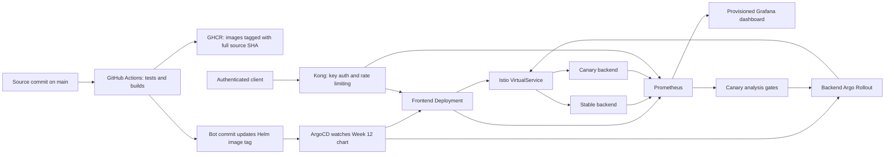

# Week 12 — End-to-End Testing and Demo Day

This directory contains the final integrated version of the internship project.
Earlier week directories remain as historical exercises. Use this guide for the
final deployment; do not apply the older standalone rollout and chart over it.

**Live validation is incomplete.** CI and local checks pass, but repeated WSL
runtime failures blocked the full deployment. Read the [verification status](evidence/STATUS.md)
for completed checks, actual evidence, and the remaining work. This is not yet a
verified final demo.

## Architecture



The frontend's `/backend` route calls the backend through the mesh. Canary traffic
weights are 10%, 30%, 60%, then 100%. Each intermediate step waits for real traffic
and checks the candidate's request metrics. The backend uses two replicas; Istio
controls request routing independently of that small replica count.

## Prerequisites

- WSL2 Ubuntu with Docker Desktop running and Ubuntu integration enabled.
- The local configuration uses a 3.5 GB WSL cap and a 3 GB minikube node to leave
  Windows memory on this 8 GB laptop. Only one demo cluster should run at a time.
  More available RAM is preferable for a full observability stack.
- Docker, minikube, kubectl, Helm, Python 3, Git and OpenSSL on the WSL PATH.
- Outbound access to GitHub, GHCR, the chart repositories and their image registries.
- GitHub Actions enabled. Its workflow requires package write access to publish
  images and repository content write access for the GitOps update.
- The two GHCR packages must be readable by the cluster. These project's published
  images were checked for anonymous access; private forks require pull credentials.

The infrastructure script pins Kubernetes 1.35.1 for newly created clusters,
Istio charts 1.30.5, Argo Rollouts 1.10.0, ArgoCD chart 10.10.2,
kube-prometheus-stack chart 92.3.0, and Kong chart 3.4.1. Exact resolved running
images are part of the verification evidence.

## Setup from an empty cluster

In WSL, clone or enter the existing repository:

```bash
git clone https://github.com/Zubair378/Devops-internship.git devops-week1
cd devops-week1
bash devops-week12/scripts/bootstrap.sh
```

For an existing checkout, use `git pull --ff-only` after preserving any local edits.
The script creates or starts the `devops-week2` minikube profile, installs the pinned
infrastructure, enables mesh injection for application pods, generates a local
Kong API key if needed, and applies the ArgoCD Application.

The first installation downloads several large images. Wait for the script to
finish rather than interrupting a Helm installation. Run it again to reconcile
the same setup. It does not destroy an existing cluster.

For a separate reproducibility test, use a different profile:

```bash
PROFILE=devops-week12-repro bash devops-week12/scripts/bootstrap.sh
```

Stop the other full cluster first on a memory-constrained host. The script scopes
Kubernetes and Helm operations to the selected profile. It never uses Terraform
destroy or deletes unrelated profiles.

ArgoCD pulls the chart from the remote repository. Local uncommitted changes do
not become desired state until they are committed and pushed.

## Release a code change

1. Modify the service code and run the tests below.
2. Commit and push to `main`.
3. GitHub Actions tests both services and publishes both images with the full
   source commit SHA.
4. Once both builds succeed, its final job commits that SHA to
   `devops-week12/chart/values.yaml`.
5. ArgoCD detects this deployment commit and reconciles the workloads.
6. Argo Rollouts uses real candidate traffic and Prometheus results before
   promoting the backend.

The source commit and deployment commit are different. Record both in the evidence.
The workflow avoids letting an older build replace newer application code.

## Local checks

```bash
python3 -m venv devops-week12/.venv
devops-week12/.venv/bin/pip install -r backend/requirements.txt
devops-week12/.venv/bin/pip install flake8==7.2.0 PyYAML==6.0.2
devops-week12/.venv/bin/pytest -v devops-week12/tests/test_services.py
(cd backend && ../devops-week12/.venv/bin/pytest -v)
(cd frontend && ../devops-week12/.venv/bin/pytest -v)
helm lint devops-week12/chart
bash -n devops-week12/scripts/bootstrap.sh
```

The parameterized tests deliberately skip the backend-only case for the frontend
and the frontend-only case for the backend.

## Open the demo

```bash
python3 devops-week12/scripts/start_demo.py
```

| Component | Local URL |
| --- | --- |
| ArgoCD | http://localhost:8080 |
| Kong application gateway | http://localhost:8000/info |
| Frontend-to-backend call through Kong | http://localhost:8000/backend |
| Prometheus | http://localhost:9090 |
| Grafana final dashboard | http://localhost:3000/d/devops-week12 |
| Alertmanager | http://localhost:9093 |

All forwards bind to localhost. Stop only the forwards created by this helper with:

```bash
python3 devops-week12/scripts/start_demo.py --stop
```

ArgoCD and Grafana use the `admin` account. Retrieve generated passwords privately:

```bash
kubectl --context=devops-week2 -n argocd get secret argocd-initial-admin-secret -o jsonpath='{.data.password}' | base64 -d
kubectl --context=devops-week2 -n monitoring get secret monitoring-grafana -o jsonpath='{.data.admin-password}' | base64 -d
```

Kong requires the `apikey` header. The generated key is in the default namespace's
`week12-api-key` Secret; the verification script reads it internally without printing it.
Unauthenticated browser access to the gateway intentionally returns HTTP 401.

## Verify the running release

Read the expected full source SHA from `chart/values.yaml`, then run:

```bash
python3 devops-week12/scripts/verify.py --sha FULL_SOURCE_COMMIT_SHA --rate-limit
```

The script checks node readiness, ArgoCD revision/sync/health, backend rollout
health, ready containers, expected image tags and image IDs, authentication,
frontend-to-backend communication, fresh scrape targets, real request counters,
Kong metrics, Grafana health, dashboard provisioning and live data for every panel.
It writes `evidence/verification.json` only after all assertions pass.

The rate limit is 120 authenticated requests per minute. This test deliberately
exhausts it; allow a new minute window before browsing the gateway again.
Background demo traffic runs inside the cluster through the frontend and Istio,
so it does not consume the gateway's external request allowance.

## Canary and monitoring behavior

- Metrics identify service, source version and pod revision. Probe and scrape
  requests are excluded from application counters.
- Analysis selects the candidate revision and requires at least five observed
  requests in the last minute with at least 95% success.
- Empty or absent metrics evaluate as failure, not artificial success.
- The frontend forwards actual backend HTTP failures instead of masking them.
- `backend.failInfo` is a controlled fault setting for the canary test. It makes
  the backend information route return HTTP 503 while readiness stays healthy,
  allowing the test to verify metric-driven rejection rather than a broken image.
  Restore it to `false` in Git after a test.
- Backend application traffic uses strict mesh mTLS. The frontend accepts Kong's
  non-mesh ingress. Dedicated internal metric ports bypass the sidecar for
  Prometheus scraping; they are not exposed by the gateway.
- ArgoCD ignores only the route weights and Service hash selectors managed by
  Argo Rollouts, preventing the two controllers from undoing each other's work.

Grafana contains request rate, error rate, latency, scrape health, revision traffic
and gateway response panels. Prometheus rules cover missing application metrics
and backend errors. Alertmanager is installed; external email/Slack notification
delivery is not configured.

## Repository layout

| Path | Purpose |
| --- | --- |
| `chart/` | Final workloads, canary checks, mesh routing, Kong resources and monitoring |
| `application.yaml` | ArgoCD Application pointing at the final chart |
| `*-values.yaml` | Pinned infrastructure chart settings |
| `scripts/bootstrap.sh` | Repeatable infrastructure installation |
| `scripts/update_images.py` | CI's image-reference update |
| `scripts/start_demo.py` | Managed localhost port forwards |
| `scripts/verify.py` | Live assertions and structured results |
| `tests/` | Application and metric contract checks |
| `evidence/` | Actual logs, results and screenshots from verification |
| `.runtime/`, `.tools/`, `.venv/` | Local ignored working files |

The application code remains in the original `backend/` and `frontend/`
directories. The CI workflow remains in GitHub's required `.github/workflows/`
location. All new implementation files are in Week 12.

## Troubleshooting

- Docker unavailable in WSL: start Docker Desktop and check Ubuntu integration.
- Quay image downloads timing out: bootstrap checks `cdn01.quay.io`, and if its
  current DNS route is unreachable, resolves it using Cloudflare DNS over HTTPS.
  It verifies TLS for the original hostname before updating only the selected
  minikube container's hosts file. Run `scripts/repair_registry_dns.py` again if
  that temporary CDN address stops responding. TLS verification stays enabled.
- API connection refused after restarting: run `minikube update-context -p devops-week2`.
- Memory or startup pressure: check node events and `docker stats`; avoid running
  two full clusters at once. Re-run bootstrap to restore its node resource limits.
- ArgoCD OutOfSync: compare the deployed Git revision with the latest image-update
  commit and inspect the failing resource.
- Canary rejected: inspect its AnalysisRun and candidate-specific metrics. Restore
  a known good Git configuration; do not remove the metric checks to obtain a
  green status.
- Grafana empty: confirm scrape targets are up and demo traffic is running.
- Repeated 429: wait for the next rate-limit window.

## Course submission

The student must complete the exit survey with their own feedback. The assignment
screenshot shows the submission window is locked; a late submission needs to be
arranged through the course's normal process. Technical changes cannot unlock it.
